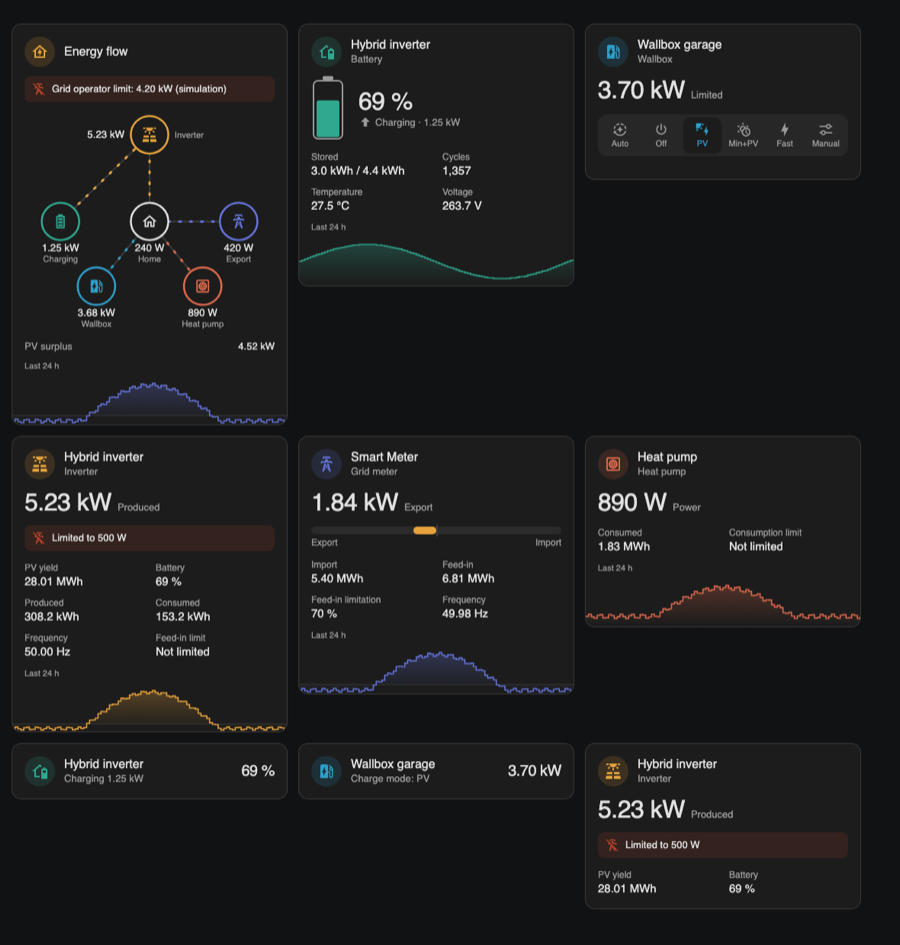

# EEBUS for Home Assistant

Connect your **EEBUS** energy devices – inverters, batteries, wallboxes, heat
pumps, smart meters and the grid operator's control box – to Home Assistant,
monitor them and control them, including **§14a EnWG** grid operator limits.

The project has two parts that work together:

| Part | What it is | Install via |
| --- | --- | --- |
| **EEBUS Bridge** (`eebus_bridge/`) | Home Assistant **add-on** that speaks EEBUS (SHIP/SPINE) on your network, based on [`enbility/eebus-go`](https://github.com/enbility/eebus-go) | Add-on store (repository URL below) |
| **EEBUS integration** (`custom_components/eebus/`) | Turns the bridge into Home Assistant devices, entities and actions | HACS |

> **You need both parts.** HACS installs only the integration – it cannot
> install add-ons. Add the add-on repository in the add-on store as well (or,
> without add-on support, run the bridge in Docker – see
> [below](#home-assistant-container-or-core-docker)).
>
> [](https://my.home-assistant.io/redirect/supervisor_add_addon_repository/?repository_url=https%3A%2F%2Fgithub.com%2FCoreTex%2Fhomeassistant-eebus)
> [](https://my.home-assistant.io/redirect/hacs_repository/?owner=CoreTex&repository=homeassistant-eebus&category=integration)

Nothing in it is specific to a vendor or network: devices are paired and
classified at runtime.

## What you can do

| Device | Monitor | Control |
| --- | --- | --- |
| **Inverter / hybrid inverter** | AC power, energy, yield, current, voltage, frequency; PV data | Consumption and feed-in limits; take part in §14a sharing (battery charging from the grid) |
| **Battery** | Power, state of charge, state of health, energy, temperature – as reported | – (via the inverter's limits) |
| **Wallbox** | Vehicle plugged in, charge state, charging power and energy, vehicle state of charge – if the wallbox reports them | **Charge modes** incl. PV-surplus charging, power or current limit, §14a dimming, failsafe |
| **Heat pump** | Power, energy | §14a dimming (consumption limit), failsafe |
| **Grid meter / gateway** | Grid power, feed-in and consumption energy, feed-in limitation | – |
| **Grid operator control box** | Received §14a / feed-in limits, heartbeat | Limits are held and **shared by demand** among your controllable devices |

What a device offers depends on the EEBUS use cases it implements; each device
only gets entities for data it really reports. Tested in the field: **KOSTAL
PLENTICORE G3** (inverter + battery: monitoring, consumption and feed-in
limits) and **KATHREIN AC40** wallbox (§14a power limit only, no measurements).

## How it works

```
  Grid operator control box ─┐                 ┌─ Inverter / battery
         (§14a limits)       │   EEBUS / SHIP  ├─ Wallboxes
                             ▼  (LAN, TLS)     ├─ Heat pumps
                 ┌────────────────────────────┐└─ Smart meter
                 │   EEBUS Bridge (add-on)     │
                 │   home energy manager:      │  - holds grid operator limits
                 │   classifies devices,       │  - shares them by demand (§14a)
                 │   monitors, sends limits    │  - failsafe, limit expiry
                 └─────────────┬──────────────┘
                               │ local REST + WebSocket API
                 ┌─────────────▼──────────────┐
                 │  EEBUS integration (HACS)   │  - one HA device per EEBUS device
                 │                             │  - charge modes, PV surplus
                 └────────────────────────────┘  - actions, repairs
```

**Safety-relevant logic runs in the add-on** (holding and sharing grid
operator limits, limit expiry, failsafe values), so it keeps working while Home
Assistant restarts. **Comfort logic runs in Home Assistant** (charge modes,
PV surplus), where any grid power sensor can be used.

## Quick start

1. **Add-on:** *Settings → Add-ons → Add-on store → ⋮ → Repositories*, add
   `https://github.com/CoreTex/homeassistant-eebus` (or use the button above),
   install **EEBUS Bridge** and start it.
2. **Pair your devices:** the add-on log shows the bridge's **Local SKI**.
   Enter it in the EEBUS settings of each device (inverter, wallbox, ...) and
   add the device's SKI to the add-on option *Trusted devices*. Alternatively
   switch on *Accept every pairing request* while pairing, then off again.
3. **Integration:** in HACS add this repository as a custom repository
   (category *Integration*), install **EEBUS**, restart Home Assistant, then
   *Settings → Devices & services → Add integration → EEBUS*. Enter your
   **Home Assistant host IP** and port `7050` (plus the API token if you set
   one).
4. **Enable control** (optional): add-on option *Control devices (Energy
   Guard)*; set *Leading inverter* to your main inverter's SKI.
5. **PV-surplus charging** (optional): *EEBUS → Configure* and pick your grid
   power sensor.

> Add-on and integration are updated separately. After updating the
> integration in HACS, **restart Home Assistant**.

### Home Assistant Container or Core (Docker)

Add-ons need Home Assistant OS or Supervised. Otherwise run the bridge as a
Docker container with host networking on a Linux machine in the same network
as your EEBUS devices – same image as the add-on, configured with an
`options.json`:

```bash
docker run -d --name eebus-bridge --restart unless-stopped --network host \
  -v /opt/eebus-bridge:/data ghcr.io/coretex/amd64-addon-eebus_bridge:0.5.1-dev
```

Use `aarch64` instead of `amd64` on ARM (e.g. Raspberry Pi). Details, a
complete `options.json` and a Docker Compose example:
[add-on documentation](eebus_bridge/DOCS.md#running-the-bridge-without-add-ons-docker).
Then continue with steps 2–5.

## Configuration

### Add-on options

Every option has a name and help text on the add-on's configuration page.

| Group | Option | Default | Purpose |
| --- | --- | --- | --- |
| Devices & pairing | `inverter_ski` | – | Leading inverter: feeds the bridge-level inverter values and limits |
| | `trusted_skis` | `[]` | Devices allowed to pair |
| | `auto_accept_trust` | off | Accept every pairing request (only while pairing) |
| Control | `enable_eg_control` | off | Send limits to devices (needed for most control features) |
| | `distribute_lpc` | off | Share a grid operator limit among wallboxes and heat pumps (§14a) |
| | `distribute_lpc_inverters` | off | Include storage registered under §14a in the sharing |
| | `enable_lpc_simulation` | off | Allow simulating a grid operator limit (testing) |
| Grid operator limits | `enable_lpc` / `enable_lpp` | on | Receive consumption / feed-in limits |
| | `auto_approve_limits` | on | Accept limits automatically |
| | `lpc_nominal_max_w` / `lpp_nominal_max_w` | 0 | Nominal power reported to the grid operator |
| Monitoring | `enable_mpc`, `enable_inverter`, `enable_battery`, `enable_mgcp`, `enable_ev` | on | Power, inverter, battery, grid meter, wallbox/vehicle data |
| Advanced | `device_brand`, `device_model`, `device_serial` | | How the bridge appears on the EEBUS network |
| | `eebus_port`, `api_port`, `api_token`, `log_level` | 4715, 7050 | Network, API protection, logging |

### Integration options (*EEBUS → Configure*)

Settings for the wallbox charge modes, each with a help text: grid power
sensor (positive when importing), reserve for the house, minimum/maximum
charging power, start and stop delay of the PV mode, control interval.

## In Home Assistant

The **EEBUS Bridge** device holds everything that concerns the whole home:

- **Grid operator limit** (consumption / feed-in): value, active, duration,
  heartbeat – what the control box currently demands.
- **Failsafe** and **nominal power** settings reported to the grid operator.
- **Totals:** PV power, battery power, inverter AC power, grid power, charging
  power, heat pump power, and the **PV surplus** seen by the charge controller.
- **§14a sharing active** / average share, **§14a simulation active**.

Every EEBUS device becomes **its own device** below the bridge with
**Connected**, **Trusted** (pair / forget) and **Device type** (how the bridge
classified it, with its use cases as attributes), plus whatever it supports:

- **Consumption limit** / **Feed-in limit**: value and a switch to apply it;
  **Consumption limited** / **Feed-in limited** show whether a limit is in
  force right now (the value as attribute `limit_w`), **§14a share** shows the
  device's part of a grid operator limit; **Failsafe power / duration**.
- **Wallboxes:** **Charge mode**, **Charge power (manual)**; with vehicle
  data also plugged in, charge state, charging power, energy, state of charge
  and current limits.
- **Measurements** as reported: power, energy, PV, battery, inverter AC side,
  grid meter values.

Bridge-level copies of the leading inverter's values, per-phase details and
other duplicates are disabled by default; the values are on the inverter's own
device. Enable them in the entity settings if you need them.

If the bridge finds wallboxes or heat pumps but *Control devices* is off, a
**repair** in *Settings → Repairs* tells you what to enable.

## Dashboard cards

The integration brings its own dashboard cards – no resource to add. After
updating, open a dashboard, choose *Add card* and search for **EEBUS**. Every
card has a visual editor: pick the device, the layout and whether to show a
history graph.



| Card | Shows | For |
| --- | --- | --- |
| **EEBUS energy flow** (`custom:eebus-energy-flow-card`) | Animated flow between PV/inverter, battery, grid, home, wallbox and heat pump; grid operator limit; PV surplus | the *EEBUS Bridge* device |
| **EEBUS inverter** (`custom:eebus-inverter-card`) | AC power, PV yield, energy, frequency, limits | inverters |
| **EEBUS battery** (`custom:eebus-battery-card`) | State of charge as a cell, charging/discharging, stored energy and capacity, cycles, temperature, voltage | inverters with a battery |
| **EEBUS wallbox** (`custom:eebus-wallbox-card`) | Charge mode switcher, charging power or applied limit, manual power slider, vehicle state of charge, §14a share | wallboxes |
| **EEBUS heat pump** (`custom:eebus-heat-pump-card`) | Power, energy, §14a dimming | heat pumps |
| **EEBUS grid meter** (`custom:eebus-grid-card`) | Import/feed-in bar, energy counters, feed-in limitation | grid meters |
| **EEBUS device** (`custom:eebus-device-card`) | Picks the matching card automatically | any EEBUS device |

Options (all cards):

| Option | Values | Default |
| --- | --- | --- |
| `device_id` | the EEBUS device | – |
| `variant` | `compact` (one line), `standard`, `detailed` (all values) | `standard` |
| `graph` | show a history graph | `true` |
| `hours` | hours of history | `24` |
| `title` | own title | device name |
| `grid_entity`, `pv_entity` | energy flow only: use your own grid / PV power sensor (positive = import / production), e.g. when no grid meter is connected via EEBUS | – |

Example:

```yaml
type: custom:eebus-wallbox-card
device_id: 0123456789abcdef0123456789abcdef
variant: standard
graph: true
hours: 12
```

Tap a value to open its history. The colours keep one meaning on every card:
amber for PV, green for the battery, indigo for the grid, cyan for wallboxes,
red-orange for heat pumps; light and dark themes follow Home Assistant.

## Wallbox charge modes

| Mode | Behaviour |
| --- | --- |
| `auto` | Default – the bridge does not intervene (wallbox / §14a only) |
| `off` | Do not charge |
| `pv` | PV surplus only; starts after the start delay once the surplus reaches the minimum power, rides through dips at minimum power for the stop delay |
| `min_pv` | Always at minimum power, more when there is surplus |
| `fast` | Full power |
| `manual` | Fixed power from *Charge power (manual)* |

Surplus = wallbox draw − grid power − reserve. Wallboxes that report the
vehicle are controlled by charging current (OPEV), §14a-only wallboxes (e.g.
KATHREIN AC40) by a power limit – this needs *Control devices*. Several
wallboxes in a PV mode share the surplus. A wallbox without its own
measurement is regulated on the grid power alone.

## §14a: grid operator limits

- **Receive:** the bridge acts as the home's controllable system. Limits from
  the grid operator's control box are accepted, shown and ended automatically
  when their duration is over.
- **Share by demand** (`distribute_lpc`): the limit is shared among the
  connected wallboxes and heat pumps – with `distribute_lpc_inverters` also
  among inverters whose storage is registered under §14a. Devices with a
  measured consumption get their demand × 1.25 + 500 W, devices without a
  measurement share the rest; the sum never exceeds the limit. Example with
  4200 W: idle storage 500 W, wallbox 3700 W. Your own limits still apply – the
  lower value wins.
- **Failsafe:** a device that got a limit from the bridge falls back to its
  failsafe power when the bridge stops (e.g. add-on restart). Set it per
  device.
- **Test without a control box** (`enable_lpc_simulation`): the action
  *Simulate grid operator limit* injects a limit and runs through the whole
  chain. It is refused while a real control box is connected or a real limit
  is active.

Limits you send yourself are your own energy management and no substitute for
§14a control by the grid operator.

## Actions

| Action | Purpose |
| --- | --- |
| `eebus.set_device_limit` | Set / apply a consumption or feed-in limit on any EEBUS device, optionally for a duration |
| `eebus.simulate_grid_limit` | Simulate a grid operator limit (testing, needs `enable_lpc_simulation`) |
| `eebus.set_consumption_limit` / `eebus.set_production_limit` | Limit the leading inverter |
| `eebus.trust_device` / `eebus.forget_device` | Pair / unpair a device by SKI |

## Automation examples

Cheap night charging, PV during the day:

```yaml
automation:
  - alias: Wallbox fast at night
    triggers:
      - trigger: time
        at: "23:00:00"
    actions:
      - action: select.select_option
        target:
          entity_id: select.kathrein_ac40_4ff37d1e_charge_mode
        data:
          option: fast
  - alias: Wallbox PV during the day
    triggers:
      - trigger: time
        at: "06:00:00"
    actions:
      - action: select.select_option
        target:
          entity_id: select.kathrein_ac40_4ff37d1e_charge_mode
        data:
          option: pv
```

Dim the heat pump for two hours during a price peak:

```yaml
- action: eebus.set_device_limit
  data:
    device_id: <your heat pump>
    value_w: 4200
    active: true
    duration_s: 7200
```

Notify when the grid operator limits the home:

```yaml
automation:
  - alias: Grid operator limit
    triggers:
      - trigger: state
        entity_id: binary_sensor.eebus_bridge_grid_operator_limit_active_consumption
        to: "on"
    actions:
      - action: notify.notify
        data:
          message: >-
            Grid operator limit:
            {{ states('sensor.eebus_bridge_grid_operator_limit_consumption') }} W
```

Entity IDs depend on your device names and language; installations from
before 0.4 keep their existing IDs.

## Troubleshooting

| Symptom | Check |
| --- | --- |
| The integration cannot connect | The EEBUS Bridge add-on is installed and started? HACS installs only the integration. Use the IP of the Home Assistant host (or Docker host) and port `7050` |
| A device reports "pairing failed" | Its SKI must be trusted (option or *Trusted* switch) **and** the bridge's SKI must be entered on the device |
| No charge mode / limits on a wallbox | *Control devices* (`enable_eg_control`) on? Integration updated **and** Home Assistant restarted? See *Settings → Repairs* |
| An inverter is left out of §14a sharing | Enable `distribute_lpc_inverters`; the add-on log names left-out inverters |
| An action is missing | The integration is older than the add-on – update it in HACS and restart |
| A value shows "unavailable" | The device does not report it (see the *Device type* attributes) |
| What exactly does a device send? | *Settings → Devices & services → EEBUS → ⋮ → Download diagnostics*: contains the raw EEBUS data of every device (measurement descriptions and values, limits) – no trace log needed. The API token is redacted |

Log lines like `operation is not supported on function electricalConnection…`
are harmless: a device does not offer an optional read.

## Supported EEBUS use cases

| Use case | Bridge role |
| --- | --- |
| LPC / LPP – Limitation of Power Consumption / Production | Controllable system (receives grid operator limits) and Energy Guard (sends limits to devices) |
| MPC – Monitoring of Power Consumption | Monitoring appliance |
| MOI / MOB – Monitoring of Inverter / Battery | Monitoring appliance\* |
| VAPD / VABD – aggregated PV / battery data | CEM |
| MGCP – Monitoring of Grid Connection Point | Monitoring appliance |
| EVSECC, EVCC, EVCEM, EVSOC, OPEV – wallbox and vehicle | CEM |

\* MOI and MOB are not in upstream `eebus-go` yet. The add-on builds against
the fork [`CoreTex/eebus-go`](https://github.com/CoreTex/eebus-go/tree/feature/uc-ma-moi-mob),
which is intended to be contributed upstream.

Not supported yet: Control of Battery, heat-pump optimisation (OHPCF), hot
water and room temperature use cases. Heat pumps can be dimmed and monitored.

## Changelog

What changed in which version: see [CHANGELOG.md](CHANGELOG.md). Highlights
of the current development line:

- **0.5.0** – dashboard cards for every device type.
- **0.4.x** – tidy settings with help texts, clear entity names, *Download
  diagnostics* with the raw data of every device.
- **0.3.x** – device classes, wallbox charge modes with PV surplus, limits and
  failsafe per device, §14a sharing by demand (incl. storage), §14a
  simulation, MOI/MOB inverter and battery monitoring.
- **0.2.0** – several devices (wallboxes) next to the inverter.

## Development

```bash
# add-on (Go)
cd eebus_bridge/src
go build ./... && go vet ./... && go test -race ./...

# integration (Python)
python -m ruff check --config ruff.toml custom_components tests
pip install --prefer-binary -r tests/requirements.txt
python -m pytest -q -o asyncio_mode=auto tests
```

The add-on's local API is documented in [`eebus_bridge/DOCS.md`](eebus_bridge/DOCS.md).

## License

Apache-2.0, see [LICENSE](LICENSE). Built on the MIT-licensed
[`enbility/eebus-go`](https://github.com/enbility/eebus-go),
[`ship-go`](https://github.com/enbility/ship-go) and
[`spine-go`](https://github.com/enbility/spine-go).
